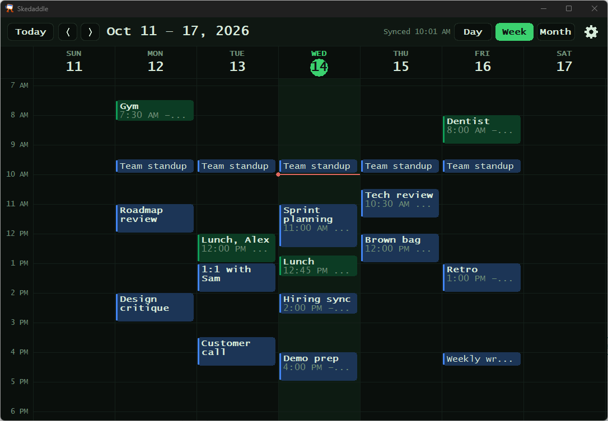
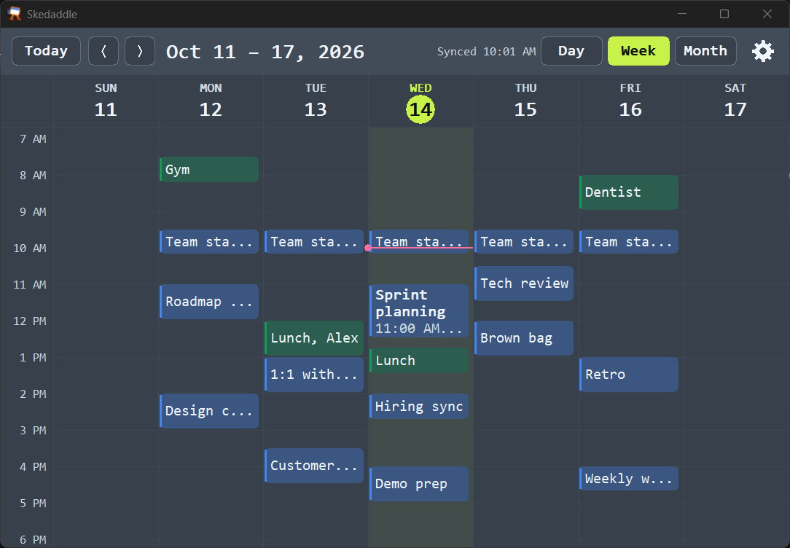
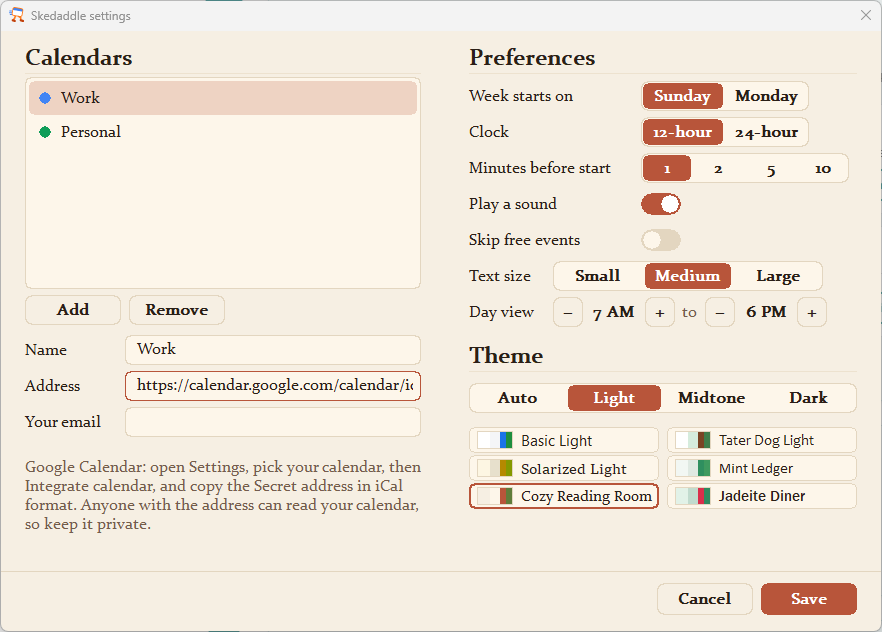
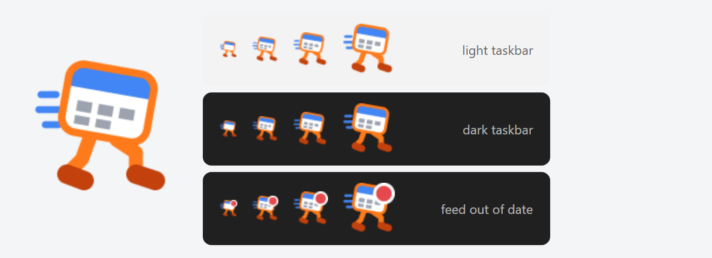

# Skedaddle

**A tiny Windows tray calendar that makes sure you never miss a meeting.**

Calendar notifications are easy to miss. A toast slides in while you are focused, Focus Assist hides it, or it appears on the wrong monitor. Skedaddle does one job: when a meeting is about to start, it flashes every screen and puts a popup in front of you with a **Join** button. Then it gets out of the way.

It reads your calendar from a standard iCalendar (`.ics`) feed, so it works with Google Calendar, Outlook, iCloud, Fastmail and others. No account, no OAuth, no cloud service.

## Screenshots

**The calendar view, in the Phosphor theme.** Click the tray icon for a day, week or month view. Each calendar gets its own color.



**Meeting details, in the Cyberdeck theme.** Click a meeting and its details open in a sidebar that narrows the calendar. Join is one click.



**Settings, in the Cozy Reading Room theme.** Pick Auto, Light, Midtone or Dark to browse the themes in that group. Each theme name is shown in its own font.



**The tray icon.** It stays readable at 16 px on light and dark taskbars, and gets a red badge when a feed is out of date.



## Lightweight by design

| | Skedaddle |
|---|---|
| Download | **one 1.2 MB exe**, no separate installer, no dependencies |
| RAM in the tray | **about 2 MB** (private memory, measured) |
| CPU when idle | **0%**: no polling loop; it wakes only for a feed sync or an alert |
| Runtime | none: no Electron, no browser engine, no .NET, no background service |

It is written in Rust against the plain Win32 API and draws its own UI with GDI. It ships no time zone database of its own: it reads zone rules from your calendar feed, or from the one already built into Windows. When you close the calendar view, it frees the view's memory and goes back to its tray-only footprint. For comparison, a typical Electron app uses well over 100 MB of RAM just to sit in the tray.

## Features

- **Alerts you cannot miss.** One minute before a meeting, every monitor flashes once and a topmost popup shows the meeting, its time, its location and a Join button. The flash repeats every minute until you dismiss the popup.
- **Works when Focus Assist is on.** Skedaddle uses its own windows, not Windows notifications, so Do Not Disturb does not hide it.
- **The popup never steals your keyboard.** It appears without focus, so a keystroke in the middle of a sentence cannot dismiss it by accident.
- **Join in one click.** It finds Google Meet, Zoom, Teams and Webex links in the event.
- **Skips what you do not need.** It does not alert for declined meetings or all-day events. Optionally, it skips events marked "free".
- **Catches up after sleep.** If your PC wakes up just after a meeting started, you still get the alert.
- **18 themes, and a font to match.** Auto follows Windows light or dark mode. Or pick from 6 light, 6 midtone and 6 dark themes, such as Phosphor (green terminal), Cyberdeck, Chill Wave (neon), Tater Dog Light, Jadeite Diner and Cozy Reading Room. A theme sets every color, the font, and the color of the alert flash.
- **Read-only calendar view.** Click the tray icon for a day, week or month view, with a detail panel for each event.
- **Works offline.** The last good copy of each feed is cached, so alerts still fire without a network.
- **Tells you when it is out of date.** If a feed has not synced for 30 minutes, the tray icon shows a warning badge.

## Requirements

- Windows 10 (version 1903 or later) or Windows 11
- A calendar that can publish an iCalendar (`.ics`) URL

## Install

1. Download `skedaddle.exe` from the [latest release](https://github.com/Cyronius/skedaddle/releases/latest).
2. Run it. Skedaddle asks once whether to install itself.
   - **Yes** copies it to `%LOCALAPPDATA%\Programs\Skedaddle\`, adds a Start Menu shortcut and an entry in Windows Settings > Apps, and starts the installed copy. No admin rights needed.
   - **No** runs it from where it is. It does not ask again. You can still install later: right-click the tray icon and select **Install Skedaddle...**.
3. On first start, Skedaddle opens its Settings window so you can add your calendar.
4. Right-click the tray icon and select **Start with Windows**, if you want it to start at sign-in.

The exe is not code-signed yet, so Windows SmartScreen can show "Windows protected your PC" on the first run. Select **More info → Run anyway**. Each release also has a `skedaddle.exe.sha256` file if you want to check the download.

To uninstall an installed copy: Windows Settings > Apps > Skedaddle > Uninstall. It asks whether to delete your settings too. If you chose not to install, untick **Start with Windows**, select **Quit**, then delete the exe and the `%APPDATA%\skedaddle` and `%LOCALAPPDATA%\skedaddle` folders.

### Build from source

1. Install Rust from [rustup.rs](https://rustup.rs).
2. Clone and build:

   ```
   git clone https://github.com/Cyronius/skedaddle.git
   cd skedaddle
   cargo build --release
   ```

3. Run `target\release\skedaddle.exe`.

## Connect your calendar

In **Settings**, press **Add** and paste your calendar's iCalendar URL. You can add more than one calendar.

**Google Calendar**
1. Open [Google Calendar](https://calendar.google.com) on the web.
2. Go to **Settings**, then select your calendar under **Settings for my calendars**.
3. In **Integrate calendar**, copy **Secret address in iCal format**.

If you do not see the secret address on a Google Workspace (work) account, your admin has turned it off. An admin can turn it on: Admin console → Apps → Google Workspace → Calendar → Sharing settings → External sharing options for primary calendars → "Share all information".

**Outlook / Microsoft 365**
1. In Outlook on the web, open **Settings → Calendar → Shared calendars**.
2. Under **Publish a calendar**, select the calendar and **Can view all details**, then **Publish**.
3. Copy the **ICS** link.

**iCloud**
1. In the Calendar app, share the calendar as a **Public Calendar**.
2. Copy the link. `webcal://` links work.

> The feed URL is a password. Anyone with it can read your calendar. Do not share it or commit it anywhere.

## Settings

Click the gear in the calendar view, or right-click the tray icon and select **Settings**.

- **Calendars**: add, edit and remove calendars; each has a name and an address; the color is assigned for you.
- **Week starts on** and **Clock** (12-hour or 24-hour).
- **Minutes before start**: alert 1, 2, 5 or 10 minutes before a meeting.
- **Day view**: the hours the day and week views fill the window with (default 7 AM to 6 PM). Scroll to see the rest of the day.
- **Text size**: Small, Medium or Large (calendar, alert popup and Settings).
- **Play a sound** and **Skip events marked free**.
- **Theme**: Auto follows Windows light and dark mode. Pick Light, Midtone or Dark to see that group (6 themes each). A theme sets every color and the font, including the screen flash.

Skedaddle checks your calendars every 5 minutes. It still alerts for 5 minutes after a meeting starts, and flashes again every minute until you dismiss the popup or 5 minutes have passed.

## Use

| Action | What it does |
|---|---|
| Left-click the tray icon | Open or close the calendar view |
| Right-click the tray icon | Open calendar, Refresh now, Settings, Start with Windows, Install Skedaddle (until installed), Quit |
| Hover the tray icon | Shows your next meeting |

Keys in the calendar view:

| Key | Action |
|---|---|
| `D` / `W` / `M` | Day, week or month view |
| `T` | Go to today |
| `←` `→` or `PgUp` `PgDn` | Previous or next day, week or month |
| `Esc` | Close the detail panel, then close the window |

## Privacy

Skedaddle talks only to the feed URLs that you give it. It has no telemetry, no accounts and no server. Your config and cached feeds stay in your Windows profile:

- `%APPDATA%\skedaddle\config.toml`: your settings and calendar addresses (Settings writes it)
- `%LOCALAPPDATA%\skedaddle\cache\`: last good copy of each feed
- `%LOCALAPPDATA%\skedaddle\alerted.txt`: which meetings already alerted, so a restart does not alert again

## Limitations

- **Read-only.** You cannot create or edit events. Use your normal calendar for that.
- **Windows only.**
- **Feed delay.** Each provider decides how fast its feed shows a new event. A meeting added a minute before it starts can be missed.
- **Uncommon repeat rules.** Rules built on week numbers, days of the year, or several times per day show their first instance only. Google, Outlook and iCloud do not create these from their normal UI.
- **Screen sharing.** The flash and popup show in a shared screen, including the meeting title. There is no setting to turn the flash off; quit Skedaddle while you present.

## Build and test

```
cargo test              # core logic tests: parsing, recurrence, time zones, alert rules
cargo build --release   # optimized build in target\release
```

The behavior is specified in [`specs/cal/spec.md`](specs/cal/spec.md). Each requirement there has either an automated test in [`specs/cal/tests/`](specs/cal/tests/) or a manual check procedure.

Code layout:

- `src/` — the platform-neutral core: iCalendar parser, recurrence expansion, alert rules, config
- `src/win/` — the Windows shell: tray icon, sync thread, flash overlay, alert popup, calendar view (plain Win32 + GDI)

## License

[MIT](LICENSE)
